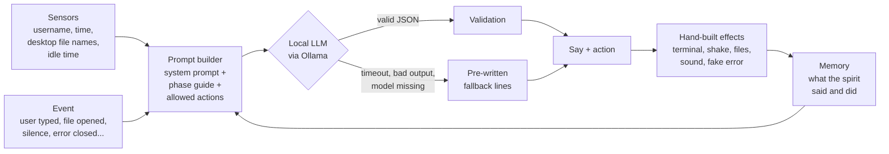

# GHOST.EXE

> A harmless haunting for your desktop. A spirit moves into your computer, watches what it can see, and decides, one move at a time, how to unsettle you.

Hacktoberfest, Challenge 4: *a paranormal presence inside the PC*, with a mandatory AI integration.


GHOST.EXE is not a window you interact with. There is no app UI. Once it starts, the spirit acts while you use your computer: your screen trembles, fake files and folders appear on the desktop, a fake system error pops up, and a green-on-black terminal starts talking to you by name. A local AI plays the spirit, so no two hauntings are the same.

A full run lasts about **6 to 9 minutes** and builds to a scripted climax followed by silence.

---

## Table of contents

- [Concept](#concept)
- [Quick start](#quick-start)
- [The haunting: five phases](#the-haunting-five-phases)
- [How the AI works](#how-the-ai-works)
- [Model choice](#model-choice)
- [Fallback and reliability](#fallback-and-reliability)
- [Sound design](#sound-design)
- [Safety](#safety)
- [What it does and does not do](#what-it-does-and-does-not-do)
- [Platform support and known limits](#platform-support-and-known-limits)
- [Architecture](#architecture)
- [Development](#development)
- [Roadmap](#roadmap)

---

## Concept

Most "haunted PC" demos throw effects at the screen and hope something sticks. GHOST.EXE is built around three ideas instead:

1. **The AI is the director, not the only actor.** The spirit does not generate effects. It *chooses* from a closed list of pre-built actions and decides what to say. The effects themselves (screen shake, fake files, sound) are hand-built, so they are always polished and always safe.
2. **It looks like it is watching you.** The spirit knows your username, the time, the names of the files on your Desktop and how long you have been idle. It uses them in what it says. None of this is faked: it reads real values, read-only.
3. **A real crescendo, not spam.** The demo is short on purpose. It escalates across five phases, with deliberate silences, and ends with a quiet last line.

**The key trick: breaking expectations.** If you close the terminal, the spirit does not let you off. About 15 seconds later the sound cuts out completely, the screen shakes with a heavy hit, and the terminal reopens by itself: *"why did you close it?"*

---

## Quick start

### Requirements

- [Node.js](https://nodejs.org/) (LTS)
- [Ollama](https://ollama.com/), a recent version (needed for the model below)
- About 9.6 GB of disk space for the model
- Speakers or headphones (the sound is half of the experience)

> Ollama is optional. Without it the spirit still works, using pre-written lines. See [Fallback and reliability](#fallback-and-reliability).

### Install and run

```bash
# 1. Get the model (one time)
ollama pull gemma4:e4b

# 2. Get the project
git clone <!-- TODO: repo URL -->
cd GHOST.EXE
npm install

# 3. Start the haunting
npm start
```

A startup window explains what is about to happen and checks your system (AI available, emergency exit working, permissions). Press **Begin haunting** when you are ready.

### Emergency exit

At any moment, press **Cmd+Shift+Q** (macOS) or **Ctrl+Shift+Q** (Windows and Linux). If the shortcut does not work on your system, type `/exit` in the terminal. The startup window tells you if the shortcut could not be registered.

### Permissions on macOS

Both are optional.

- **Screen Recording**: used to take a screenshot that is then shaken. Without it, only the fake icons shake.
- **Desktop folder access**: used to read the *names* of the files on your Desktop. Without it, the spirit simply does not mention them.

macOS may ask you to restart the app after you grant Screen Recording.

---

## The haunting: five phases

The phases advance by time and by what you do. Each phase has a minimum and a maximum duration: if you chat, it moves on sooner; if you say nothing, it moves on anyway. The spirit also speaks on its own after a stretch of silence, and throws in random breaths, whispers and clicks.

| Phase | What happens | Sound | Actions the spirit may use |
|---|---|---|---|
| **1. Omen** | Light tremors, then a fake file appears: `DON'T OPEN ME`. If you ignore it, the spirit nudges you now and then. | Faint drone | none (scripted) |
| **2. Contact** | You open the file. A terminal types out a greeting using your username. The spirit is curious, soft, like someone waking up. | Drone, no heartbeat | `shake`, `spawn_file` |
| **3. Conversation** | You can type to it. It answers, quotes real details about you, and reacts to which file you open. | Louder drone, slow heartbeat | + `spawn_folder`, `move_file` |
| **4. Intrusion** | Short, threatening lines. Files move and vanish, a fake system error appears. | Harsh drone, fast heartbeat | + `remove_file`, `fake_error` (max 2) |
| **5. Climax and silence** | Scripted. Silence, five escalating shakes, every file disappears one by one, one last hit, then total silence. | Maximum, then nothing | none: words only |

Every phase change is staged: the room goes quiet for a moment, then a hit lands, then the spirit speaks first.

### The ending

1. 2.5 seconds of silence.
2. Five shakes, closer and closer together, with drone and heartbeat at maximum.
3. Every fake file on the desktop vanishes, one by one.
4. A last heavy hit, then the sound is cut dead.
5. In the silence, the terminal reopens on its own and the AI writes its **last words** (generated while the chaos was playing, so there is no delay).
6. The terminal closes. Ten seconds of empty desktop. The app quits.

**The last line, after the fact.** When the ending completes, the app leaves a tiny marker in its own data folder. The next time you launch GHOST.EXE, before anything else, the terminal appears for a few seconds: *"you came back. i never left."*

---

## How the AI works

### The director loop



For every turn the spirit receives:

- **phase**: how intense to be (omen, contact, conversation, intrusion, climax).
- **phase guide**: tone and length for that phase, for example *contact: curious and soft, max 14 words*, *intrusion: threatening and clipped, 6 to 14 words*.
- **allowed actions**: only the actions that make sense right now. The main process computes this list from the phase and from what exists on screen, so the AI can never ask to remove a file that is not there.
- **facts**: real values read from the machine.
- **memory**: the spirit's recent lines and actions, so it does not repeat itself and can refer back to what it did.
- **event**: what just happened.

It answers with a JSON object:

```json
{ "say": "you left the terminal open for 4 minutes, anna.", "action": "none" }
```

### A closed list of actions

`none`, `shake`, `spawn_file`, `spawn_folder`, `move_file`, `remove_file`, `fake_error`

The output format is enforced with a JSON schema (the `action` field is an enum), and the code checks it again: an action that is not allowed in the current phase silently becomes `none`. The prompt also asks the spirit to use `none` most of the time, because restraint is what makes the actions land.

### Perception

| Fact | Source | Notes |
|---|---|---|
| Username | operating system | |
| Time | system clock | HH:MM |
| Desktop file names | Desktop folder | Up to 8, **names only**, read-only. Empty if permission is denied. |
| Idle time | power monitor | Seconds since last input |
| What you just did | the app itself | Typed text, which fake file or folder you opened, whether you clicked OK on the fake error |

### Memory

The spirit remembers what it said and did, and what you did. The last six entries go into each prompt. The full list is used on the app side to reject repeated lines.

---

## Model choice

**Gemma 4 `e4b`, run locally through [Ollama](https://ollama.com/).**

Why a local model:

- **Privacy.** The spirit sees your username and your Desktop file names. They never leave your machine. The app only talks to `127.0.0.1`.
- **Works offline,** with no API key and no cost per run.
- **Fits the product.** The spirit is supposed to live *inside* your computer.

Why this model: it is small enough to run on a laptop while still producing short, atmospheric lines, and it supports structured JSON output. Thinking mode is turned off for latency, and responses are capped at 120 tokens, since the spirit should say very little.

Calls use temperature 0.8 for variety, and the model is kept loaded for 30 minutes. The app starts loading it while you read the startup warning, so it is usually ready by the time the first omen plays.

---

## Fallback and reliability

A haunting that stops working halfway is worse than no haunting, so the AI is never a single point of failure.

- **Ollama not running, or model not installed:** detected at startup and shown in the startup window. The spirit goes straight to pre-written lines, with no waiting.
- **Slow model:** each call has a timeout (8 seconds once the model is warm, 20 seconds before) and one retry.
- **Bad output:** the reply is rejected, and retried or replaced by a fallback line, if it:
    - is not valid JSON (JSON surrounded by extra text is still recovered),
    - is empty or not a string,
    - breaks character (for example, mentions being an AI or a model),
    - repeats something the spirit already said.

  Replies longer than 30 words are cut.
- **Pre-written lines** exist for every phase and respect the same action rules. They also avoid lines already used.
- The reply carries a `source` field (`ai` or `fallback`), and the app prints `[stats] spirit lines: ai=X fallback=Y` when it quits.
- **Hand-written moments never depend on the model:** the greeting and the "why did you close it?" trick are scripted.
- Typed messages are queued, so each one gets an answer, in order.

---

## Sound design

There are **no audio files**. Everything is synthesized live with the Web Audio API inside the overlay.

| Sound | How it is made |
|---|---|
| **Drone** | Three slightly detuned oscillators that beat against each other, through a slowly breathing low-pass filter. Gets louder and brighter with each phase. |
| **Heartbeat** | A two-part "lub-dub" built from falling sine pulses. Speeds up from about 54 to 118 bpm. |
| **Whisper** | Breath-like noise shaped by vowel formants, in irregular syllables, with a bit of reverb and a random position in the stereo field. |
| **Breath** | A short inhale, a pause, a long exhale. Different every time. |
| **Glitch** | Electrical clicks and a short buzz, fired by every screen shake. |
| **Thud** | A low impact with a noise burst, fired by every strong shake and by the climax. |
| **Silence** | Everything cuts out at once. Used before big moments, because the quiet is what makes the hit scary. |

Sound is tied to the shake effect in the overlay itself, so image and audio cannot drift apart.

---

## Safety

GHOST.EXE is designed to be scary, never harmful.

- **Startup warning** with a plain description of what it does, a notice about shaking and flashes, and a system check. Nothing happens until you press **Begin**.
- **Emergency exit** is armed before anything else: Cmd/Ctrl+Shift+Q, with `/exit` in the terminal as a backup.
- **Click-through overlay:** the overlay does not block your desktop. It only becomes clickable while your mouse is over a fake file or the fake error box.
- **The error box is fake.** It is drawn by the app, styled for your OS. It is not a real system dialog.

### Content warning

The app shakes the screen and produces brief flashes. Do not run it if you are sensitive to flashing images.

---

## What it does and does not do

**It does**

- Draw a transparent, always-on-top, click-through overlay over your screen.
- Take a screenshot of your screen (only with your permission on macOS) and shake it.
- Show fake files, folders and a fake error box that exist only inside the overlay.
- Read your username, the time, the *names* of up to 8 Desktop files, and your idle time.
- Talk to a local model on `127.0.0.1`.
- Save one tiny marker file in its own data folder when the ending completes.

**It does not**

- Create, change, move or delete any real file or folder.
- Use your webcam or microphone. (Voice is simulated with text.)
- Read file contents. Only the names on the Desktop.
- Send anything over the internet.
- Install anything, run in the background after exit, or start by itself.

---

## Platform support and known limits

| Platform | Status |
|---|---|
| macOS | Developed and tested (MacBook Air, Apple silicon) |
| Linux | Tested |
| Windows | **Not tested yet.** It uses the same cross-platform code and a Windows-styled error box, but it has not been run on a real Windows machine |

Known limits:

- **Linux:** a running compositor is needed for the transparent overlay. Wayland can behave differently from X11 for transparency, always-on-top and global shortcuts. X11 is the most reliable. If the exit shortcut does not register, use `/exit`.
- **macOS:** without Screen Recording permission, the shake only affects the fake icons, which is a weaker effect. Desktop file names are only available with Desktop folder access.
- **Primary display only:** the overlay covers the main monitor.
- **The phases are driven by time and by number of turns.** They are not yet adaptive to what the model says.
- **The active application is not a sensor.** It would need a native module, which is risky across three operating systems.
- **The model is big** (about 9.6 GB) and the first reply can be slow if it is not loaded yet. The fallback covers that.
- **The AI can still be odd.** It is filtered for format, repetition and character breaks, but it is a small model and it will sometimes produce a flat line.
- **Fake icons are original SVG drawings** in the spirit of each OS. They are not copies of any official icon set.

---

## Architecture

| File | Role |
|---|---|
| `main.js` | The director. Phase state machine, spirit turns, memory, action rules, climax and ending, startup window, emergency exit. |
| `llm.js` | The brain. Talks to Ollama, validates replies, handles timeouts, retries and pre-written fallbacks. Never throws. |
| `sensors.js` | What the spirit can perceive. Read-only. |
| `overlay.html` | The transparent overlay: shake effect, fake files, fake error box, and the whole Web Audio sound engine. |
| `icons.js` | OS-flavoured SVG icons (macOS, Windows, Linux) for the fake files, folders and error box. |
| `terminal.html` | The fake terminal: green on black, typed one character at a time, with an input line that only appears when the spirit has finished. |
| `warning.html` | The startup warning and system check. |
| `preload.js` | The narrow bridge between the windows and the main process. |

The main process owns the logic (phases, AI, memory). The overlay and the terminal are renderers that only display and play what they are told, and report what the user did.

---

## Development

```bash
npm install
npm start
```

While developing (not in a packaged build) there are shortcuts to test without waiting through the whole crescendo:

| Shortcut | What it does |
|---|---|
| Cmd/Ctrl+Shift+N | Skip to the next phase. The last skip starts the climax. |
| Cmd/Ctrl+Shift+A | Run the next action (file, folder, move, fake error, remove), bypassing the AI. |
| Cmd/Ctrl+Shift+T | Play the next sound from the test list. |

Useful console output: `[phase] -> ...`, `[spirit] phase=... source=ai|fallback`, `[llm] attempt N failed: ...`, `[stats] ...`.

All the timing and intensity values live in one table at the top of `main.js` (`PHASES`), and the sound levels in `overlay.html`.

---

## Roadmap

- **A persistent spirit** that remembers you across sessions, not only the one-line aftermath.
- **Voice recognition** (opt-in), so you can talk to it instead of typing.
- **An event plugin system** so anyone can add new scares as small self-contained modules.
- **More languages** for the spirit.
- **The active application as a sensor** ("you have been in that spreadsheet for an hour").
- **Windows testing and packaged builds** for all three platforms.
- **Multi-monitor support.**
- **Adaptive phases**, where the model's own read of the user can move the crescendo faster or slower.

---
